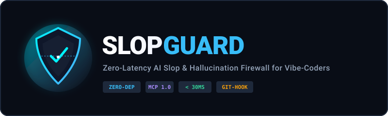

<div align="center">
  
  <br>

  [English](README.md) | **Русский** | [简体中文](README.zh.md)

  <br>

  
  
  
  
  

  <br>

  <h3>Защитите кодовую базу от накопления скрытого ИИ-мусора и галлюцинаций.</h3>

  <p>
    <b>SlopGuard</b> — сверхбыстрый фаервол на <b>чистом Rust</b> и <b>MCP-сервер</b> (Model Context Protocol),<br>
    который перехватывает недописанные заглушки, дубликаты утилит, обходы типов и разговоры ИИ в комментариях<br>
    <b>до того</b>, как они попадут в ваш git-репозиторий.
  </p>

  <code>cargo install slopguard</code>

</div>

---

## Проблема: Накопление скрытого ИИ-мусора (Code Slop)

При активном вайбкодинге в Cursor, Claude Code, Windsurf или Antigravity нейросетевые агенты неизбежно засоряют кодовую базу:

1. **Недописанные заглушки**: `// TODO: implement later`, `throw new Error("not implemented")` или пустые `catch (e) {}`, тихо проглатывающие критические ошибки.
2. **Размножение дубликатов**: Агент забывает, что у вас уже есть функция `formatDate()` в `src/utils/date.ts`, и создает копию под другим именем в новом файле.
3. **Деградация типизации**: Чтобы компилятор не ругался, модель заменяет строгие типы на `any`, `Record<string, any>`, `@ts-ignore` или костыли `as unknown as any`.
4. **Фантомные зависимости**: Агент импортирует библиотеки (`axios`, `lodash`), которых нет в вашем `package.json`.
5. **Дрейф скоупа (Agent Drift)**: Вы просите поменять цвет кнопки, а агент попутно трогает конфиги, `.env` и схемы данных.
6. **Разговорный мусор в комментариях**: Засорение кода репликами вида `// Вот исправленный код:`, `// Шаг 1: Добавляем слушатель`.

> **Классические линтеры (ESLint, Ruff, Biome) не ловят такие проблемы.** Они проверяют синтаксис, но не понимают семантической деградации кода ИИ.

---

## Возможности

- **100% Native Rust**: Единый автономный бинарник без лишних рантаймов. Мгновенный запуск (<5мс).
- **Анализ Git Diff**: Сканирует только измененные строки в рабочей копии или в индексе git.
- **Встроенный MCP-сервер**: Подключается к Cursor, Claude Code и Windsurf, позволяя агенту проверять свой код перед завершением шага.
- **Автоматическая очистка**: Команда `slopguard fix` удаляет разговорные комментарии ИИ в один клик.
- **Pre-commit хук за 1 секунду**: Установка через `slopguard hook install`.
- **Индекс чистоты кода (AI Hygiene Score 0–100)**: Наглядный отчет в терминале и экспорт SVG-бейжей.

---

## Быстрый старт

### Установка

```bash
cargo install slopguard
```

Либо сборка из исходников:

```bash
git clone https://github.com/avelo/slopguard.git
cd slopguard
cargo build --release
```

### Основные команды

```bash
# Проверка текущих незакоммиченных изменений
slopguard check

# Проверка только подготовленных файлов (для pre-commit)
slopguard check --staged

# Режим наблюдения в реальном времени при вайбкодинге
slopguard watch

# Создание файла конфигурации .slopguardrc.json
slopguard init

# Вывод в формате JSON для тулинга и скриптов
slopguard check --json

# Вывод в формате аннотаций GitHub Actions
slopguard check --github

# Генерация пайплайна GitHub Actions CI за 1 секунду
slopguard ci

# Полное сканирование всех файлов проекта
slopguard all

# Автоматическое удаление разговорных комментариев ИИ
slopguard fix

# Установка git-хука в .git/hooks/pre-commit
slopguard hook install

# Генерация SVG-бейжа чистоты кодовой базы
slopguard badge ./slopguard-badge.svg
```

---

## Настройка MCP (Cursor, Claude Code, Windsurf)

В SlopGuard встроен официальный STDIO-сервер **Model Context Protocol (MCP)** прямо в бинарник.

### Настройка в Cursor

Добавьте в ваш `mcp.json` (`~/.cursor/mcp.json` или `.cursor/mcp.json` проекта):

```json
{
  "mcpServers": {
    "slopguard": {
      "command": "slopguard",
      "args": ["mcp"]
    }
  }
}
```

### Доступные MCP-инструменты

- `slopguard_scan_diff`: Позволяет агенту проверить текущий git diff на заглушки и обходы типов.
- `slopguard_check_snippet`: Проверяет фрагмент кода в памяти перед записью на диск.
- `slopguard_sanitize_file`: Очищает целевой файл от разговорных артефактов ИИ.

---

## Лицензия

MIT © [avelo](https://github.com/avelo)
